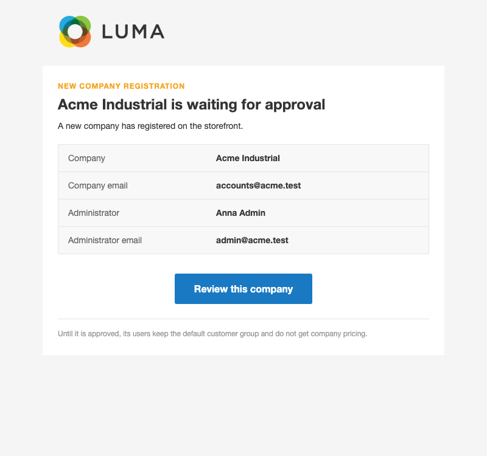
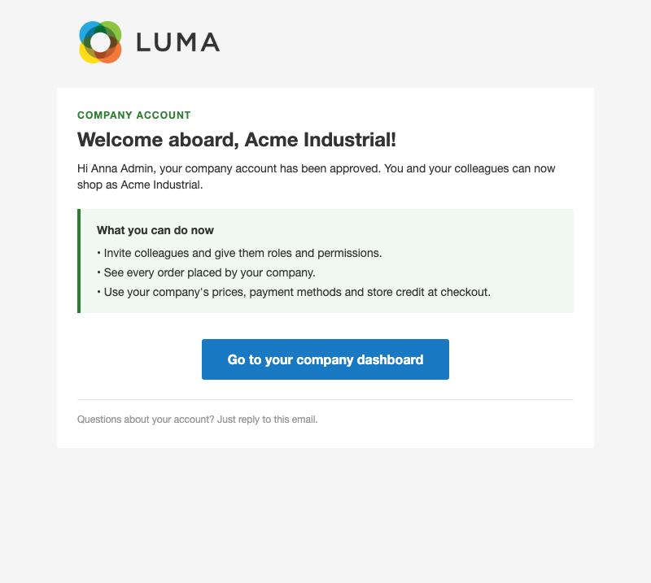
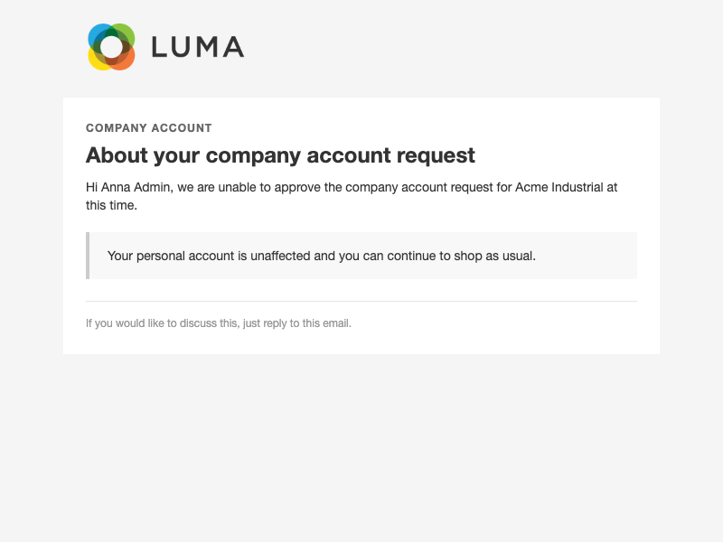

# B2B Company Accounts for Magento 2

Company accounts with users, roles, branches, company pricing, payment rules and store credit — on Magento Open Source.

Magento Open Source treats every buyer as an individual shopper. Company accounts, company roles, company credit and
hierarchies are part of Adobe Commerce's B2B edition only. This module adds them to Open Source: a business registers
once, its administrator brings in colleagues and decides what each of them may do, and you control the company's
prices, payment methods and credit from the admin.

## Features

- **Company accounts** — create companies in the admin, or let businesses register on the storefront, on their own
  page or as an optional section of the normal *Create an Account* form.
- **Approval workflow** — storefront registrations start as *Pending* and get no company pricing until you approve
  them. Approve, reject or block companies one by one or in bulk; the company is emailed when it is approved or
  declined, and your store's General Contact is told about every new registration.
- **Company users** — the company administrator adds colleagues from *My Company*; new users get Magento's standard
  "set your password" email. You can also assign customers to a company from the admin customer form or in bulk from
  the customer grid.
- **Roles and permissions** — the company defines its own roles (view or edit the profile, manage users and roles,
  see child companies, see everyone's orders, see or spend store credit, and the permissions of the optional B2B
  add-ons). Members see only the pages their role allows, and nobody can grant themselves more than they hold.
- **Company hierarchy** — parent companies create and manage child companies (branches, departments). A child
  inherits its parent's customer group, payment rules and roles unless it sets its own.
- **Company orders** — members with the permission see every order placed by anyone in their company and its child
  companies, and can open them.
- **Company pricing** — link a company to a customer group and all its members are moved into it, so Magento's
  native tier prices, catalog price rules and cart price rules give them their B2B prices. Pricing applies only
  while the company is active.
- **Payment method rules per company** — allow every payment method or only a chosen list, per company or inherited
  from the parent.
- **Company store credit** — a credit balance shared by the whole company tree, offered at checkout as a *Store
  Credit* payment method when it covers the full order. Admins top up or deduct credit with a full history;
  credit memos and cancellations return the credit automatically. Members see the balance and history on the
  storefront, and only roles you allow can pay with it.
- **Safe by design** — company pages are never served from the full-page cache, every page checks the visitor's
  company and role, and a blocked or pending company loses its pricing, payment rules and credit across its whole
  branch.
- **Redesignable emails** — branded registration, approval and rejection emails.

### Optional add-ons

- **B2B Order Approval** (`Tonyapps_B2bOrderApproval`) — carts above a threshold need the company administrator's
  approval before checkout.
- **B2B Quick Order** (`Tonyapps_B2bQuickOrder`) — order by SKU and quantity or by CSV upload.
- **B2B Requisition Lists** (`Tonyapps_B2bRequisitionLists`) — saved, shared company shopping lists.
- **B2B Quotes** (`Tonyapps_B2bQuotes`) — negotiated prices on a cart.

## How it works

**Storefront.** A logged-in customer registers a company; once you approve it they become its company administrator.
Members get a *My Company* section in their account menu with the pages their role allows: *My Company*, *Company
Users*, *Roles and Permissions*, *Child Companies*, *Company Orders* and *Store Credit*. Customers who are not in a
company see nothing new.

**Admin.** *Customers › Companies* lists all companies with status, customer group and hierarchy. From each company
you edit its details, parent company, customer group, address and allowed payment methods, manage its roles, and open
its store credit page. The customer edit form gets a *Company* fieldset (company and role).

**Checkout.** Members check out with the normal Magento checkout. Payment methods the company may not use are
hidden; *Store Credit* appears only when the shared balance covers the whole order total and the member is allowed to
spend it.

## Screenshots

Emails as sent (Luma theme, 2026-11-09).

**New company registration (to the store)**



**Company account approved**



**Company account request declined**



## Redesigning the emails

The emails can be redesigned visually with the [Email Designer](https://github.com/tonyappsorg/magento2-email-designer)
(`Tonyapps_EmailDesigner`): open **Marketing › Communications › Email Designer**, start a design for the email and
save it. Then pick the saved design in this module's email template settings under **Stores › Configuration ›
Tonyapps › B2B Company Account › Emails**. The default template is used until a design is picked.

## Good to know

- Store credit pays for the **whole order or nothing** — no split payment with a card.
- A customer belongs to **one company** at a time; there is no switching between companies.
- Added users exist immediately — there is no "invited, not yet accepted" state.
- Companies are global across websites, and store credit is kept in the base currency; stores running different base
  currencies per website are not supported.
- Built for the **Luma** storefront and checkout; Hyvä and custom one-step checkouts are not supported yet.
- No REST or GraphQL API, and no sales representative per company.
- Built from scratch for Open Source — there is no migration path to Adobe Commerce B2B, and the two cannot run
  together.

## Requirements

- Magento Open Source 2.4.8
- PHP 8.3 or 8.4

## Installation

```sh
composer require tonyapps/module-b2b
bin/magento setup:upgrade
```

## Configuration

- **Stores › Configuration › Tonyapps › B2B Company Account** — enable the module, allow storefront registration,
  offer it during customer registration, and pick the email templates.
- **Stores › Configuration › Sales › Payment Methods › Store Credit (B2B Companies)** — enable the store credit
  method, its title, new order status and sort order.
- **Customers › Companies** — companies, roles, payment methods and store credit.
- **System › Permissions › User Roles** — *Companies* and *Adjust Store Credit* control which admins can manage
  companies and change credit.

## For developers

Architecture, decisions, data model and tests are in [AGENTS.md](AGENTS.md).
